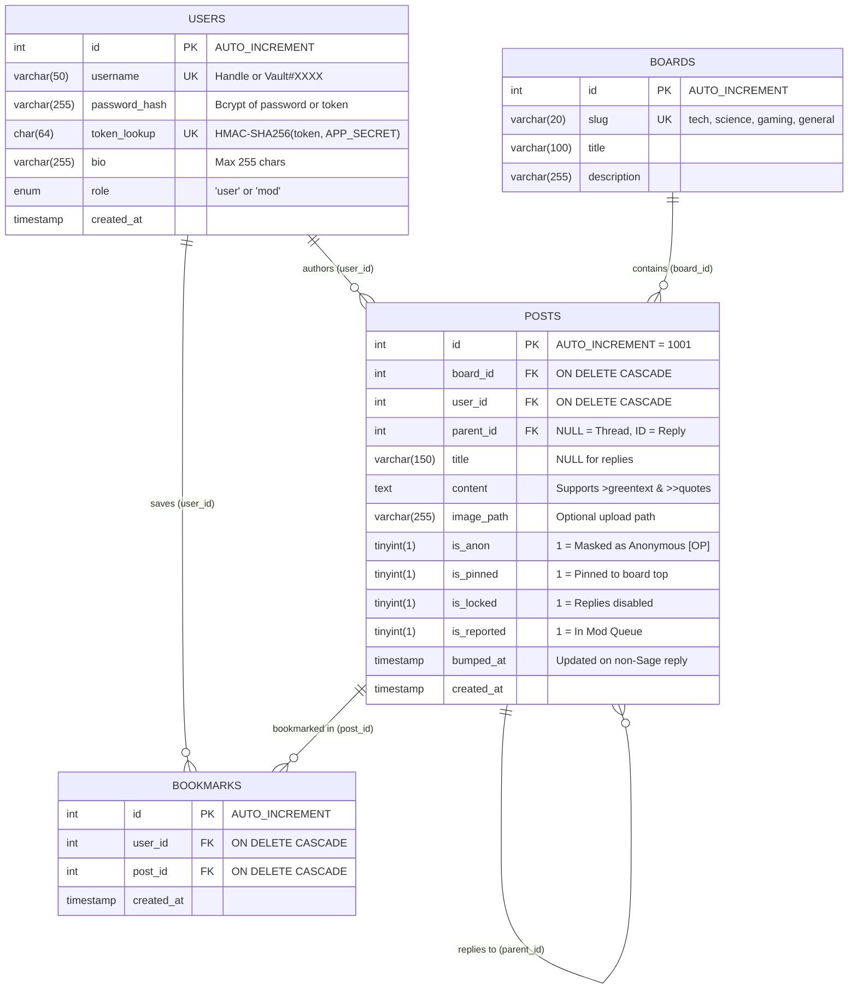
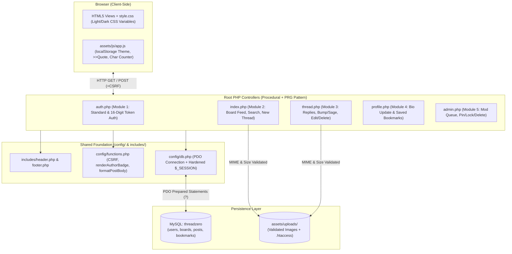

# ThreadZero — System Architecture & Developer Guide (`ARCHITECTURE.md`)

> **How to use this document:**
> - **For Teammates:** Read Sections 1–5 to understand how the project works, how the folders are organized, and what you need to prepare for our lab viva.
> - **For AI Coding Assistants (ChatGPT / Claude / Gemini / Cursor / Copilot):** If you are using AI to write or edit a file, attach or paste this entire document and use the prompt template in **Section 7**.

---

## 1. Coding Rules (For Developers & AI Agents)

Whether a human teammate or an AI agent writes code for this repository, it **MUST** follow these strict simplicity rules so everyone can defend and modify the code live during our lab evaluation:

1. **Keep Code Live-Modification Friendly (Viva Safe):**
   - During the lab evaluation, the examiner may ask any team member to **modify the code on the spot** (e.g., adding a new input field, changing a SQL filter, adding a table column, or altering a character limit).
   - **NO over-engineering:** Do not use PHP classes/OOP hierarchies, custom routing engines, autoloaders, closures, or cryptic one-liners.
   - Write **flat, top-to-bottom procedural PHP** and **plain Vanilla JS** with self-explanatory variable names (`$thread_id`, `$is_anon`, `$search_query`).
   - Write every SQL query string directly above the `$pdo->prepare()` line where it runs.
2. **Strict Tech Stack:**
   - **Frontend:** Semantic HTML5 and **one hand-written stylesheet** (`assets/css/style.css`) built with Flexbox and media queries; CSS custom properties provide the light/dark themes. **Vanilla JavaScript** (ES6 DOM manipulation). No Tailwind, Bootstrap, React or Vue, and no CSS/JS build step.
   - **Backend:** PHP 8.x using `PDO` prepared statements (`?` placeholders) and native `$_SESSION`.
   - **Database:** MySQL / MariaDB (Strictly **5 normalized tables**: `users`, `boards`, `posts`, `bookmarks`, `notifications`).
3. **Viva-Ready Comments:**
   - Add a clear 1-line comment above every SQL query (e.g., `// [SQL UPDATE] Bump parent thread to the top of the board`) and key `if/else` block so any teammate can read and explain the logic in 10 seconds.

---

## 2. Project Overview & Core Features

**ThreadZero** is a privacy-first hybrid discussion board and imageboard engine that combines the community structure of Reddit, the fast minimalist thread mechanics of 4chan/Hacker News, and the zero-knowledge login system of Mullvad VPN.

### A. Dual Authentication (`auth.php`)
Users can sign up and log in using two methods stored in the same `users` table:
1. **Standard Account:** Traditional `username` + `password` (hashed via `password_hash()`).
2. **Mullvad-Style Token Account:** One-click generation of a random 16-digit account token (e.g., `4829-1049-8372-6154`) using `random_int()`. The system auto-assigns a handle using the last 4 digits (e.g., `Vault#6154`). The plaintext token is shown **once** at creation; the database stores only `token_lookup = HMAC-SHA256(token, APP_SECRET)` for indexed lookup and `password_hash = password_hash(token, PASSWORD_DEFAULT)` for verification. No email or personal data required.

### B. Asymmetric Anonymity (`index.php` & `thread.php`)
Designed to allow open discussion while preventing anonymous harassment in the comments:
1. **Anonymous Threads (OP):** When starting a new thread (`parent_id IS NULL`), a user can check `Post Thread Anonymously` (`is_anon = 1`). The UI displays `Anonymous [OP]`, while the database still stores `user_id` internally so the author can **Edit (`UPDATE`)** or **Delete (`DELETE`)** their own thread.
2. **Accountable Replies:** Replies (`parent_id IS NOT NULL`) always display the poster's `@username` or `@Vault#6154` handle—**except** if the original creator of an anonymous thread replies inside their own thread, which automatically masks them as `Anonymous [OP]`.

### C. Imageboard Mechanics (`thread.php` & `assets/js/app.js`)
- **Bump vs. Sage:** Posting a reply updates the parent thread's `bumped_at = NOW()` so active discussions rise to the top—unless the user checks `Sage (Do not bump)`.
- **Text Formatting:** Lines starting with `>` render in green (`.greentext`). Typing `>>1002` creates a clickable link (`#p1002`) that jumps to post `#1002`.

### D. Frontend (`assets/css/style.css` + `assets/js/app.js`)

All original HTML prototypes (`login.html`, `register.html`, `index.html`, `thread.html`, `profile.html`) have now been folded into their PHP pages, so there are **no static `.html` routes left**. The production pages share one hand-written stylesheet (`assets/css/style.css`) and one small script (`assets/js/app.js`).

When extending a page:
1. Include `config/db.php`, `config/functions.php`, `includes/header.php` and `includes/footer.php`.
2. Render every user string through `htmlspecialchars()` and every query through PDO `?` placeholders.
3. Add a hidden `action` input to every `POST` form (values in §4.1) and call `csrfField()`.
4. Do not add a second stylesheet or a framework; extend `assets/css/style.css` instead.
5. Keep client-side helpers in `assets/js/app.js`; there is no build step.

**Theming.** The light theme is the default. `toggleTheme()` sets `data-theme="dark"` on the `<html>` element and saves the choice in `localStorage`; an inline script in `includes/header.php` re-applies it before first paint so there is no white flash. All colours live in CSS custom properties at the end of `style.css`, with `html[data-theme="dark"]` overrides for cards, inputs, tables, badges, form messages and inline action links.

---

## 3. Official 5-Table Database Schema (`sql/schema.sql`)

All team members and AI tools must strictly use this 5-table schema:

```sql
CREATE DATABASE IF NOT EXISTS threadzero
    CHARACTER SET utf8mb4
    COLLATE utf8mb4_unicode_ci;
USE threadzero;

DROP TABLE IF EXISTS notifications;
DROP TABLE IF EXISTS bookmarks;
DROP TABLE IF EXISTS posts;
DROP TABLE IF EXISTS boards;
DROP TABLE IF EXISTS users;

-- 1. USERS (Supports Standard Username/Password OR 16-Digit Mullvad Token)
CREATE TABLE users (
    id INT AUTO_INCREMENT PRIMARY KEY,
    username VARCHAR(50) UNIQUE NOT NULL,          -- e.g., 'arjun_dev' or 'Vault#6154'
    password_hash VARCHAR(255) DEFAULT NULL,       -- bcrypt of the password OR of the 16-digit token
    token_lookup CHAR(64) DEFAULT NULL,            -- HMAC-SHA256(token, APP_SECRET); indexed lookup only
    bio VARCHAR(255) DEFAULT 'Hello, I use ThreadZero.',
    role ENUM('user', 'mod') DEFAULT 'user',
    created_at TIMESTAMP DEFAULT CURRENT_TIMESTAMP,
    UNIQUE KEY unique_token_lookup (token_lookup)  -- fast token login; NULL for standard accounts
) ENGINE=InnoDB DEFAULT CHARACTER SET utf8mb4 COLLATE utf8mb4_unicode_ci;

-- 2. BOARDS (Discussion Categories)
CREATE TABLE boards (
    id INT AUTO_INCREMENT PRIMARY KEY,
    slug VARCHAR(20) UNIQUE NOT NULL,              -- e.g., 'tech', 'science', 'gaming', 'general'
    title VARCHAR(100) NOT NULL,
    description VARCHAR(255) NOT NULL
) ENGINE=InnoDB DEFAULT CHARACTER SET utf8mb4 COLLATE utf8mb4_unicode_ci;

-- 3. POSTS (Self-Referencing: parent_id IS NULL = Thread, parent_id = ID = Reply)
CREATE TABLE posts (
    id INT AUTO_INCREMENT PRIMARY KEY,
    board_id INT NOT NULL,
    user_id INT NOT NULL,
    parent_id INT DEFAULT NULL,
    title VARCHAR(150) DEFAULT NULL,               -- NULL for replies
    content TEXT NOT NULL,
    image_path VARCHAR(255) DEFAULT NULL,
    is_anon TINYINT(1) DEFAULT 0,                  -- 1 = Masked as "Anonymous [OP]"
    is_pinned TINYINT(1) DEFAULT 0,
    is_locked TINYINT(1) DEFAULT 0,
    is_reported TINYINT(1) DEFAULT 0,              -- 1 = Flagged for Moderator review
    bumped_at TIMESTAMP DEFAULT CURRENT_TIMESTAMP,
    created_at TIMESTAMP DEFAULT CURRENT_TIMESTAMP,
    FOREIGN KEY (board_id) REFERENCES boards(id) ON DELETE CASCADE,
    FOREIGN KEY (user_id) REFERENCES users(id) ON DELETE CASCADE,
    FOREIGN KEY (parent_id) REFERENCES posts(id) ON DELETE CASCADE
) ENGINE=InnoDB DEFAULT CHARACTER SET utf8mb4 COLLATE utf8mb4_unicode_ci AUTO_INCREMENT = 1001;

-- 4. BOOKMARKS (Many-to-Many Junction Table: Users <-> Saved Threads)
CREATE TABLE bookmarks (
    id INT AUTO_INCREMENT PRIMARY KEY,
    user_id INT NOT NULL,
    post_id INT NOT NULL,
    created_at TIMESTAMP DEFAULT CURRENT_TIMESTAMP,
    UNIQUE KEY unique_bookmark (user_id, post_id),
    FOREIGN KEY (user_id) REFERENCES users(id) ON DELETE CASCADE,
    FOREIGN KEY (post_id) REFERENCES posts(id) ON DELETE CASCADE
) ENGINE=InnoDB DEFAULT CHARACTER SET utf8mb4 COLLATE utf8mb4_unicode_ci;

-- 5. NOTIFICATIONS (Reply alerts for thread owners)
CREATE TABLE notifications (
    id INT AUTO_INCREMENT PRIMARY KEY,
    recipient_id INT NOT NULL,
    actor_id INT DEFAULT NULL,
    post_id INT NOT NULL,
    thread_id INT NOT NULL,
    type VARCHAR(50) NOT NULL DEFAULT 'reply',
    is_read TINYINT(1) NOT NULL DEFAULT 0,
    created_at TIMESTAMP DEFAULT CURRENT_TIMESTAMP,

    FOREIGN KEY (recipient_id)
        REFERENCES users(id)
        ON DELETE CASCADE,

    FOREIGN KEY (actor_id)
        REFERENCES users(id)
        ON DELETE SET NULL,

    FOREIGN KEY (post_id)
        REFERENCES posts(id)
        ON DELETE CASCADE,

    FOREIGN KEY (thread_id)
        REFERENCES posts(id)
        ON DELETE CASCADE,

    INDEX idx_recipient_read (recipient_id, is_read),
    INDEX idx_recipient_created (recipient_id, created_at)

) ENGINE=InnoDB DEFAULT CHARACTER SET utf8mb4 COLLATE utf8mb4_unicode_ci;

-- SEED DEFAULT BOARDS (safe to re-run)
INSERT IGNORE INTO boards (slug, title, description) VALUES
('tech', 'Technology & Systems', 'Software engineering, AI architectures, Linux, and hardware.'),
('science', 'Science & Research', 'Physics, mathematics, space exploration, and breakthroughs.'),
('gaming', 'Interactive Media & Gaming', 'PC/console gaming, game design, emulation, and anime.'),
('general', 'General Discussion', 'Open discussions, Q&A, productivity, and creative projects.');

```

### 3.1 Demo Seed Data (`sql/seed.sql`)

`sql/seed.sql` rebuilds a complete demo dataset after `schema.sql`: four users (one moderator, three regular accounts and one token account), six threads across the four boards, seven replies, five bookmarks and two reported posts. It truncates all five tables first, so treat it as a development-only reset rather than a migration. The file starts with `SET NAMES utf8mb4` so the em dash in the sample text survives imports from clients whose default charset is a legacy Windows code page.

Demo logins: `mod_arjun` / `password123` (moderator), `priya_dev` / `password123`, `rohan_sec` / `password123`, and `Vault#6154` with token `4829-1049-8372-6154`. The seeded `token_lookup` uses the development fallback `APP_SECRET` from `config/db.php`; regenerate it if `THREADZERO_APP_SECRET` is set.

### 3.2 Privacy & Security Rules (Non-Negotiable)

These rules protect the token-login and anonymity model. Do not skip them "to save time".

1. **Never store secrets in plaintext.** Passwords and 16-digit tokens are stored only as `password_hash()` output. The token itself is shown **once** at signup and cannot be recovered.
2. **Use a keyed lookup hash.** `token_lookup = hash_hmac('sha256', $token, APP_SECRET)` lets login find the row in one indexed query without storing a reversible value. `APP_SECRET` is read from the `THREADZERO_APP_SECRET` environment variable, with a development fallback in `config/db.php`; set a real value before deploying so the committed repo cannot reproduce your hashes.
3. **Verify, don't compare.** After the lookup, run `password_verify($token, $row['password_hash'])` before creating the session.
4. **Generic error messages.** Always show "Invalid username or token" — never reveal whether an account exists.
5. **Harden the session.** Call `session_regenerate_id(true)` immediately after login, and set cookies `HttpOnly`, `SameSite=Lax`, and `Secure` whenever the request is HTTPS.
6. **CSRF protection.** Every `POST` form includes a hidden token compared against `$_SESSION['csrf_token']`.
7. **Escape output.** Every user string is printed through `htmlspecialchars()`. Every query uses PDO `?` placeholders.
8. **Minimise data.** No emails, phone numbers, or IP logging. `users` stores only `username`, `password_hash`, `token_lookup`, `bio`, `role`, `created_at`.
9. **Rate-limit login.** After 5 failed attempts in one session, add a short `sleep()` delay and show a warning.
10. **Be honest about anonymity.** `is_anon = 1` hides the author from other users, but `user_id` is still stored so the author can edit/delete and moderators can act. It is pseudonymity, not untraceability — say this clearly in the viva.

### 3.3 Entity-Relationship (ER) Diagram

The diagram below mirrors the DDL in `sql/schema.sql`, including the self-referencing `posts.parent_id` relationship that stores replies.



---

## 4. Core Shared Code (`config/db.php` & `config/functions.php`)

Every root page (`index.php`, `thread.php`, `auth.php`, `profile.php`, `admin.php`) includes these two files at the top. There are no static `.html` routes any more.

### `config/db.php`

```php
<?php
// Harden the session cookie before starting the session
if (session_status() === PHP_SESSION_NONE) {
    session_set_cookie_params([
        'httponly' => true,
        'samesite' => 'Lax',
        'secure'   => !empty($_SERVER['HTTPS']) && $_SERVER['HTTPS'] !== 'off'
    ]);
    session_start();
}

// Generate a CSRF token for this session if one does not exist yet
if (empty($_SESSION['csrf_token'])) {
    $_SESSION['csrf_token'] = bin2hex(random_bytes(32));
}

// Server-side pepper for token lookup hashes.
// Set THREADZERO_APP_SECRET in the environment for any non-local deployment.
$app_secret = getenv('THREADZERO_APP_SECRET');
define('APP_SECRET', ($app_secret !== false && $app_secret !== '')
    ? $app_secret
    : 'threadzero-dev-secret-change-me');

$host = 'localhost';
$dbname = 'threadzero';
$db_user = 'root';
$db_pass = ''; // Default Laragon/XAMPP password is empty

try {
    $pdo = new PDO("mysql:host=$host;dbname=$dbname;charset=utf8mb4", $db_user, $db_pass, [
        PDO::ATTR_ERRMODE => PDO::ERRMODE_EXCEPTION,
        PDO::ATTR_DEFAULT_FETCH_MODE => PDO::FETCH_ASSOC
    ]);
} catch (PDOException $e) {
    // Log the real error, never print it to the browser
    error_log('ThreadZero database connection failed: ' . $e->getMessage());
    http_response_code(500);
    exit('ThreadZero is temporarily unavailable. Please try again later.');
}
```

### `config/functions.php`

```php
<?php
function isLoggedIn() {
    return isset($_SESSION['user_id']);
}

function isMod() {
    return isset($_SESSION['role']) && $_SESSION['role'] === 'mod';
}

// Prints the hidden input that every POST form must contain
function csrfField() {
    $token = htmlspecialchars($_SESSION['csrf_token'] ?? '', ENT_QUOTES, 'UTF-8');
    return '<input type="hidden" name="csrf_token" value="' . $token . '">';
}

// Returns true only when the posted token matches the session token
function verifyCsrfToken($submittedToken) {
    return isset($_SESSION['csrf_token'])
        && hash_equals($_SESSION['csrf_token'], (string)$submittedToken);
}

// Decides whether to show "Anonymous [OP]" or "@username"
function renderAuthorBadge($post, $parentThread = null) {
    // 1. Main thread with "Post Anonymously" checked
    if ($post['parent_id'] === null && (int)$post['is_anon'] === 1) {
        return '<span class="badge-anon">Anonymous [OP]</span>';
    }
    // 2. Reply written by the creator of an anonymous thread
    if ($post['parent_id'] !== null && $parentThread !== null) {
        if ((int)$parentThread['is_anon'] === 1 && (int)$post['user_id'] === (int)$parentThread['user_id']) {
            return '<span class="badge-anon">Anonymous [OP]</span>';
        }
    }
    // 3. Regular accountable post/reply
    $username = htmlspecialchars($post['username'] ?? 'User', ENT_QUOTES, 'UTF-8');
    return '<span class="badge-user">@' . $username . '</span>';
}

// Formats >greentext and >>1001 quote links
function formatPostBody($text) {
    $safe = htmlspecialchars($text, ENT_QUOTES, 'UTF-8');
    $safe = preg_replace('/&gt;&gt;(\d+)/', '<a href="#p$1" class="quote-link">&gt;&gt;$1</a>', $safe);
    $safe = preg_replace('/^(&gt;.*)$/m', '<span class="greentext">$1</span>', $safe);
    return nl2br($safe);
}
```

### 4.1 Form Fields, Session Keys & Redirect Rules

The static prototypes already use these names. Do not invent new ones; the PHP pages must match them exactly.

**POST field names (hidden `action` decides the handler):**

| Form | `action` value | Other fields |
|---|---|---|
| Standard signup | `signup` | `username`, `password`, `confirm_password` |
| Standard login | `login` | `username`, `password` |
| Token signup | `token_signup` | none (server generates the token) |
| Token login | `token_login` | `token` (16 digits, hyphens/spaces allowed in input) |
| Logout | `logout` | none |
| Create thread | `create_thread` | `board_id`, `title`, `content`, `is_anon`, `image` (optional file) |
| Reply | `post_reply` | `content`, `sage`, `image` (optional file) |
| Edit post | `edit_post` | `post_id`, `content` |
| Delete post | `delete_post` | `post_id` |
| Toggle bookmark | `toggle_bookmark` | none |
| Report post | `report_post` | `post_id` |
| Update bio | `update_bio` | `bio` |
| Moderation | `unflag`, `toggle_pin`, `toggle_lock`, `delete_post` | `post_id` |

**GET field names:** `search`, `sort` (`bumped` or `newest`), `board` (slug), `id` (thread), `edit` (post being edited), `page` (future).

**Session keys:** `user_id`, `username`, `role`, `csrf_token`, `failed_logins`. On logout, clear `$_SESSION`, expire the session cookie, then `session_destroy()`.

**Redirect rules:**
- Successful standard login or signup → `index.php` (POST → redirect → GET).
- Successful logout → `auth.php`.
- Token signup uses POST → redirect → GET as well: the plaintext token is stashed in `$_SESSION['generated_token']`, the POST redirects to `auth.php?mode=register&show_token=1`, and that GET renders the token once before deleting it from the session. The token never appears in the URL, and the response sends `Cache-Control: no-store`.
- Validation or login failure → re-render the same form with `$error` and HTTP 200; never redirect with the error in the URL.
- `auth.php` handles both login and signup modes; `login.html` and `register.html` have been removed now that their markup lives in `auth.php`.

**Validation limits (enforce server-side and mirror in HTML):**
- `username`: 3–20 characters, letters/digits/underscore only, unique.
- `password`: minimum 8 characters; `confirm_password` must match.
- `token`: strip everything except digits, then require exactly 16 digits.
- `title`: 3–150 characters. `content`: 1–5,000 characters. `bio`: maximum 255 characters.
- `image`: optional; JPG/PNG/GIF/WebP, maximum 2 MB, stored in `assets/uploads/` with a random filename.

---

## 5. Modular Feature Specifications

Any developer can pick up and build one of these self-contained modules:

* **Module 1: `auth.php` (Dual Login & Registration)**
* **Standard Signup:** Inserts `username` and `password_hash($pass, PASSWORD_DEFAULT)` into `users`.
* **Mullvad Token Generator:** Builds `$token = sprintf('%04d-%04d-%04d-%04d', random_int(0,9999), random_int(0,9999), random_int(0,9999), random_int(0,9999));`, then `$lookup = hash_hmac('sha256', $token, APP_SECRET)` and `$token_hash = password_hash($token, PASSWORD_DEFAULT)`. Inserts the handle (`Vault#` + last 4 digits) plus `password_hash` and `token_lookup`; a duplicate handle or lookup hash (`SQLSTATE 23000`) is retried with a fresh token. The plaintext token is shown **once** with a copy button and a warning to save it.
* **Token Login:** Normalises the input (strip spaces and dashes), validates it is 16 digits, runs `SELECT * FROM users WHERE token_lookup = ?`, then verifies with `password_verify($token, $row['password_hash'])`. On success: `session_regenerate_id(true)`, set `$_SESSION['user_id']` and `$_SESSION['role']`.
* **Login hardening:** Generic error message for both flows, and a `sleep(1)` delay plus a "too many attempts" warning after repeated failures in the same session.
* **Form contract:** one `auth.php` page serves four `action` values — `signup` (`username`, `password`, `confirm_password`), `login` (`username`, `password`), `token_signup` (no fields), and `token_login` (`token`). Logout is a fifth `action` (`logout`) posted with a CSRF token.


* **Module 2: `index.php` (Board Feed, Search & New Thread)**
* Displays boards from `boards` table, a keyword search input (`WHERE p.content LIKE ? OR p.title LIKE ?`), and a sort dropdown (`bumped_at DESC`, `created_at DESC`).
* Includes the "New Thread" form (`board_id`, `title`, `content`, optional image upload to `assets/uploads/`, and `is_anon` checkbox).
* Counts replies per thread dynamically or via subquery and lists threads ordered by `is_pinned DESC, bumped_at DESC`.


* **Module 3: `thread.php` (Replies, Bump/Sage, Edit/Delete, Bookmark, Report)**
* Fetches parent thread (`WHERE id = ? AND parent_id IS NULL`) and all replies (`WHERE parent_id = ? ORDER BY created_at ASC`).
* Reply form has a `Sage (Don't bump)` checkbox. If unchecked, runs `UPDATE posts SET bumped_at = NOW() WHERE id = ?`.
* Shows inline **Edit** (`UPDATE posts SET content = ?`) and **Delete** (`DELETE FROM posts WHERE id = ?`) buttons if `$_SESSION['user_id'] == $post['user_id']`; moderators may delete any post.
* Includes a one-click **Bookmark** toggle (`INSERT` / `DELETE` on `bookmarks`) and a **Report** button (`UPDATE posts SET is_reported = 1 WHERE id = ?`).
* Locked threads reject new replies for regular users; moderators can still post.
* Successful actions use POST → redirect → GET; bookmark/report messages are passed through a one-shot session flash.


* **Module 4: `profile.php` (User Dashboard)**
* Form to update `bio` (`UPDATE users SET bio = ? WHERE id = ?`), limited to 255 characters.
* Lists all threads/replies created by `$_SESSION['user_id']` (even anonymous ones).
* Lists saved bookmarks (`SELECT ... FROM bookmarks JOIN posts`) with a Remove button (`DELETE FROM bookmarks`).
* Successful updates use POST → redirect → GET with a one-shot session flash.


* **Module 5: `admin.php` (Moderator Control Panel)**
* Accessible when `isMod()` is true; non-moderators receive a 403 page.
* Shows an HTML `<table>` of flagged posts (`WHERE is_reported = 1`) and threads, with form buttons to **Approve/Unflag** (`SET is_reported = 0`), **Pin/Unpin** (`SET is_pinned = NOT is_pinned`), **Lock/Unlock** (`SET is_locked = NOT is_locked`), or **Delete** (`DELETE FROM posts WHERE id = ?`).
* Pin and lock always resolve to the parent thread, so acting on a reported reply still affects its thread.
* Successful actions use POST → redirect → GET with a one-shot session flash.


* **Module 6: `assets/js/app.js` + `assets/css/style.css` (Theme & Client-Side Polish)**
* `toggleTheme()` flips the `data-theme="dark"` attribute on `<html>`, updates the navbar button label/ARIA state, and stores the choice in `localStorage`.
* A small inline script in `includes/header.php` applies the saved theme before first paint, preventing a white flash on reload.
* Dark mode uses CSS custom properties (`--bg`, `--card-bg`, `--text-main`, `--border-color`, …) plus `html[data-theme="dark"]` overrides for cards, inputs, tables, badges, form messages and inline action links.
* `quotePost()` appends `>>ID` to the reply box and dispatches an `input` event so the live character counter stays in sync.
* Live character counters are attached to `textarea[name="content"]` and `textarea[name="bio"]`; thread/reply forms are blocked client-side when the trimmed content is shorter than 2 characters.


* **Module 7: `notifications.php` + `includes/header.php` (Notifications)**
* When another user replies to a thread, `thread.php` inserts a notification for the thread owner into the `notifications` table.
* The notification stores the recipient ID, actor ID, reply post ID, thread ID, notification type and read status.
* `includes/header.php` displays a Notifications link and the unread notification count for the logged-in user.
* `notifications.php` displays the logged-in user's notifications, including the actor username, thread title and reply preview.
* **View Reply** navigates directly to the relevant reply using its post ID anchor.
* Users can mark one notification as read, mark all notifications as read, or delete individual notifications.
* All notification actions use POST requests with CSRF protection. Database queries restrict access to the logged-in user's own notifications.
* Deleting a user or related post automatically cleans up associated notifications through foreign key constraints.


### 5.1 System Architecture & Request Flow

This diagram shows how a browser request moves through the root PHP controllers, the shared `config/` + `includes/` foundation, and the MySQL/upload storage layer.



---

## 6. Team Viva Preparation Checklist (By Role)

### A. Frontend Developers (2 Members — `assets/css/style.css`, `assets/js/app.js`, `includes/header.php`)

* **Know how to explain:** How `assets/css/style.css` is organised (one commented section per page plus shared `.badge-anon`, `.badge-user`, `.greentext`, `.quote-link` and theme helpers), Flexbox layout, the mobile `@media (max-width: 600px)` block, how CSS custom properties plus `data-theme`/`localStorage` drive dark mode, HTML form `method="POST"` and `enctype="multipart/form-data"`, and how `includes/header.php`/`includes/footer.php` wrap every page.
* **Practice live changes:** Change a theme colour, move the navbar, add a minimum character length check in JS, or add a `confirm()` dialog on delete buttons.

### B. Backend Developers (2 Members — `auth.php`, `index.php`, `thread.php`, `profile.php`, `admin.php`)

* **Know how to explain:** PHP `$_SESSION` lifecycle and `session_regenerate_id(true)` after login, PDO prepared statements (`?` placeholders) vs. SQL injection, how `random_int()` creates the 16-digit token, why the DB stores `token_lookup` (HMAC-SHA256 with `APP_SECRET`) and a `password_hash()` instead of the raw token, how `renderAuthorBadge()` checks `$parentThread['is_anon']`, and how a request moves from a root controller through `config/`/`includes/` to MySQL (see the request-flow diagram in §5.1).
* **Practice live changes:** Adding a new field to the profile page, restricting an action to moderators only, or changing the `>greentext` regex character.

### C. Database Architect (1 Member — `schema.sql`, `seed.sql`, SQL Queries)

* **Know how to explain:** Primary vs. Foreign Keys across the 5 tables (see the ER diagram in §3.3), the self-referencing Foreign Key in `posts` (`parent_id` pointing to `posts.id`), how `ON DELETE CASCADE` cleans up replies and bookmarks automatically, how notifications are stored in the notifications table and reports are tracked using the posts.is_reported boolean flag, and `JOIN` queries between `posts` and `users`.
* **Practice live changes:** Running `GROUP BY` queries in phpMyAdmin to count posts per user, or adding a `views` column to `posts`.

---

## 7. Copy-Paste Prompt for Teammates Using AI

When you want an AI assistant (ChatGPT, Claude, Gemini, Cursor) to write or modify your assigned file, copy this entire `ARCHITECTURE.md` file into the chat and add this prompt at the bottom:

> "Act as a helpful developer following the `ARCHITECTURE.md` specification above. Write the complete, self-contained code for `[INSERT FILENAME, e.g., profile.php]`. Follow all rules in Section 1: use flat procedural PHP with PDO prepared statements, the existing classes from `assets/css/style.css` (no CSS framework), and clear comments above every SQL query (`SELECT`, `INSERT`, `UPDATE`, `DELETE`) so I can easily explain and modify the code during my college viva."
